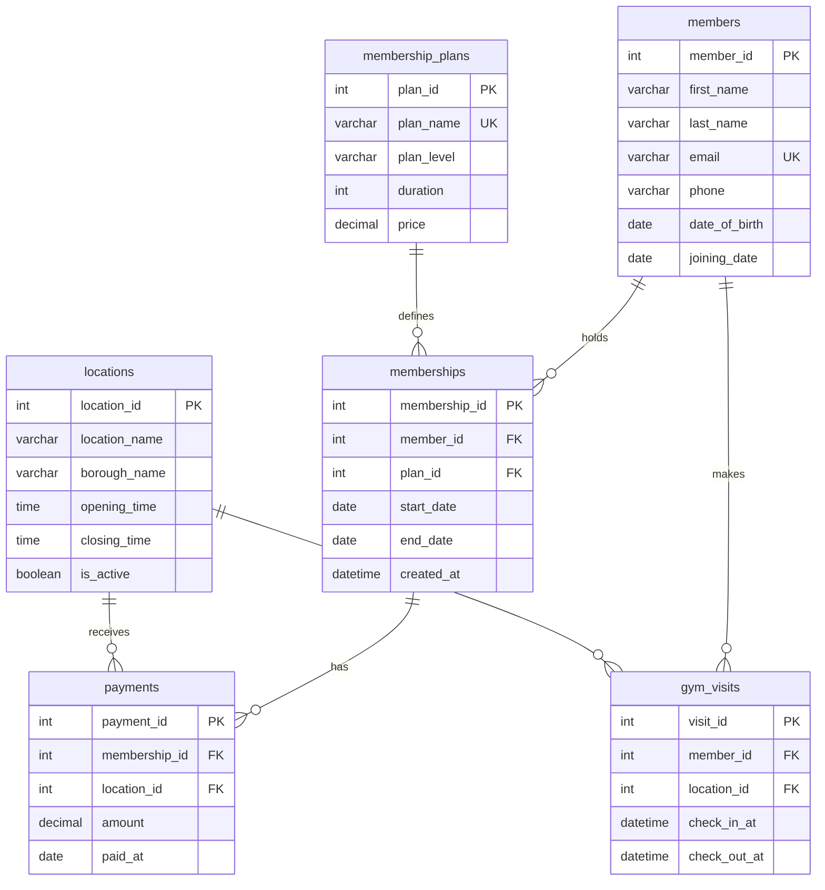

# Step 3 — Logical ER Diagram and DBML Design

**Project:** CIS 3400 — Luxury Gym Management Database  
**Database target:** MySQL 8  
**Model:** Simplified relational database with multiple gym locations  
**DBML source:** `diagrams/03_gym_database.dbml`  
**ER diagram:** `diagrams/03_gym_erd.png`  
**Status:** Logical design completed; MySQL tables are created in a later step.

## 1. Purpose

The purpose of Step 3 is to turn the six tables defined in Step 2 into a logical database model. The model uses **DBML (Database Markup Language)** to describe tables, fields, primary keys, foreign keys, and relationships. The ER diagram provides a visual view of how the tables connect.

| Design item | Total |
|---|---:|
| Tables | **6** |
| Attributes (columns) | **34** |
| Primary keys | **6** |
| Foreign keys | **6** |
| One-to-many relationships | **6** |

This step documents the design only. Actual MySQL `CREATE TABLE` statements and validation rules will be written in Step 5.

## 2. The six tables

| Table | Attributes | Purpose |
|---|---:|---|
| `members` | 7 | Basic information about gym members. |
| `membership_plans` | 5 | Membership options, prices, and duration. |
| `memberships` | 6 | Links members to plans and keeps membership history. |
| `gym_visits` | 5 | Tracks check-ins and check-outs at gym branches. |
| `payments` | 5 | Records membership payments credited to a location. |
| `locations` | 6 | Names, boroughs, and standard operating hours of branches. |

No additional tables are part of this version. Free trials, exercise classes, amenities, reservations, and employee scheduling are **out of scope**.

## 3. Crow's Foot ER diagram

The diagram below uses **Crow's Foot notation**. `||` represents exactly one parent, and `o{` represents zero or many child records.



The ER diagram can also be generated in [dbdiagram.io](https://dbdiagram.io) using the DBML in Section 5.

## 4. Relationships and cardinalities

All six foreign keys are **required** (`NOT NULL`). Each child record refers to exactly one parent record; a parent may have no related child records or many.

| Parent table (1) | Child table (0..many) | Foreign key in child |
|---|---|---|
| `members` | `memberships` | `memberships.member_id` |
| `membership_plans` | `memberships` | `memberships.plan_id` |
| `members` | `gym_visits` | `gym_visits.member_id` |
| `locations` | `gym_visits` | `gym_visits.location_id` |
| `memberships` | `payments` | `payments.membership_id` |
| `locations` | `payments` | `payments.location_id` |

**Notes:**

- `memberships` links a member to a selected plan. A member can have several membership records over time.
- `gym_visits` links a member to the **actual location visited**. A valid membership may be used at any active branch.
- `payments` connects to `memberships`, so the member associated with a payment can be found through a join; no extra `payments.member_id` column is needed.
- The payment's `location_id` records the branch **credited with the payment**. It does not necessarily indicate where the member visited that day.

## 5. DBML design

Save the following as **`diagrams/03_gym_database.dbml`** and paste it into [dbdiagram.io](https://dbdiagram.io) to generate the ER diagram.

```dbml
// CIS 3400 — Luxury Gym Management Database
// Step 3: Logical design (exactly 6 tables, 34 attributes, 6 foreign keys)

Table members {
  member_id int [pk, increment]
  first_name varchar(60) [not null]
  last_name varchar(60) [not null]
  email varchar(255) [not null, unique]
  phone varchar(25)
  date_of_birth date
  joining_date date [not null]
}

Table membership_plans {
  plan_id int [pk, increment]
  plan_name varchar(100) [not null, unique]
  plan_level varchar(50) [not null]
  duration int [not null, note: 'Duration in months']
  price decimal(10,2) [not null]
}

Table memberships {
  membership_id int [pk, increment]
  member_id int [not null]
  plan_id int [not null]
  start_date date [not null]
  end_date date
  created_at datetime [not null]
}

Table gym_visits {
  visit_id int [pk, increment]
  member_id int [not null]
  location_id int [not null]
  check_in_at datetime [not null]
  check_out_at datetime
}

Table payments {
  payment_id int [pk, increment]
  membership_id int [not null]
  location_id int [not null]
  amount decimal(10,2) [not null]
  paid_at date [not null]
}

Table locations {
  location_id int [pk, increment]
  location_name varchar(100) [not null]
  borough_name varchar(50) [not null]
  opening_time time [not null]
  closing_time time [not null]
  is_active boolean [not null, default: true]
}

Ref: memberships.member_id > members.member_id
Ref: memberships.plan_id > membership_plans.plan_id
Ref: gym_visits.member_id > members.member_id
Ref: gym_visits.location_id > locations.location_id
Ref: payments.membership_id > memberships.membership_id
Ref: payments.location_id > locations.location_id
```

The `Ref:` statements describe the six links shown in the ER diagram. For example, `memberships.member_id > members.member_id` means that many membership records may point to one member.

## 6. Business and data-integrity rules

The DBML preserves the field definitions from Step 2:

- Each table has one auto-incrementing integer primary key.
- `members.email` and `membership_plans.plan_name` are unique.
- Every membership belongs to an existing member and plan.
- Every gym visit belongs to an existing member and location.
- Every payment belongs to an existing membership and location.
- `memberships.end_date` may be `NULL` when no ending date has been recorded.
- `gym_visits.check_out_at` may be `NULL` until a member leaves.
- `locations.is_active` defaults to `TRUE`.
- Membership plans are not tied to a single location; valid members may visit any active branch.
- Historical membership, visit, and payment records should be retained for reporting.

**Checks to implement in MySQL later:** `duration > 0`, `price >= 0`, `amount > 0`, `end_date >= start_date` (when provided), and `check_out_at >= check_in_at` (when provided). These are implementation rules, **not new columns**. Primary and foreign keys alone cannot determine whether a member is currently eligible to enter a branch.

Because `memberships` has no separate status field, the team must define how to interpret an open-ended membership (`end_date IS NULL`) when reporting active subscriptions.

## 7. Questions supported by the six-table design

| # | Business question | Tables used |
|---|---|---|
| 1 | Which locations, days, and hours have the most gym visits? | `gym_visits`, `locations` |
| 2 | Which membership plans are selected most often? | `memberships`, `membership_plans` |
| 3 | How do recorded payment totals compare across gym locations and boroughs? | `payments`, `locations` |
| 4 | How does gym attendance vary across member age groups? | `members`, `gym_visits` |
| 5 | How often do members visit, and how long is an average completed visit? | `members`, `gym_visits` |

Age-group analysis should exclude or separately label members without a birth date. Visit-duration analysis should use completed visits with both check-in and check-out timestamps.

## 8. Save and review the diagram

1. Open [dbdiagram.io](https://dbdiagram.io).
2. Create a new diagram and select **DBML**.
3. Paste the content of `diagrams/03_gym_database.dbml`.
4. Verify that the editor shows **6 tables** and **6 relationship lines**.
5. Arrange the tables so the relationships are easy to follow.
6. Export the ER diagram as `diagrams/03_gym_erd.png`.
7. Commit both the DBML source and the updated design document to GitHub.

### Expected repository files

```text
cis3400-gym-database/
├── docs/
│   ├── 01_business_requirements.md
│   ├── 02_entities_and_attributes.md
│   └── 03_database_design.md
└── diagrams/
    ├── 03_gym_database.dbml
    └── 03_gym_erd.png
```

## 9. Completion checklist

- [x] Include only the six approved tables.
- [x] Preserve all 34 attributes from Step 2.
- [x] Define one primary key per table.
- [x] Define the six required foreign keys.
- [x] Show all six one-to-many relationships.
- [x] Document nullable fields and important business rules.
- [ ] Confirm the diagram renders correctly in dbdiagram.io.
- [ ] Review the design for 1NF, 2NF, and 3NF in Step 4.

**Next step:** Step 4 — Normalize the database schema.

**Suggested commit message:** `Update Step 3 ER diagram and DBML to six-table design`
