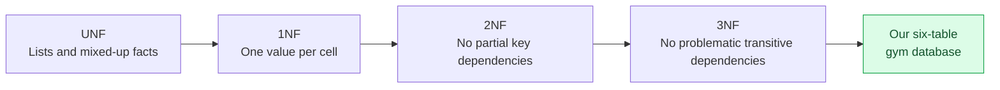
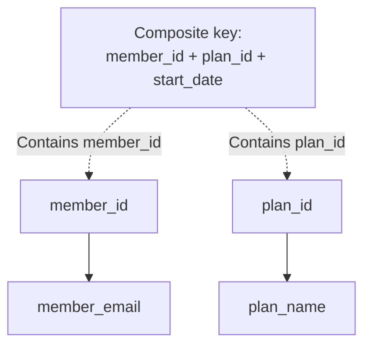
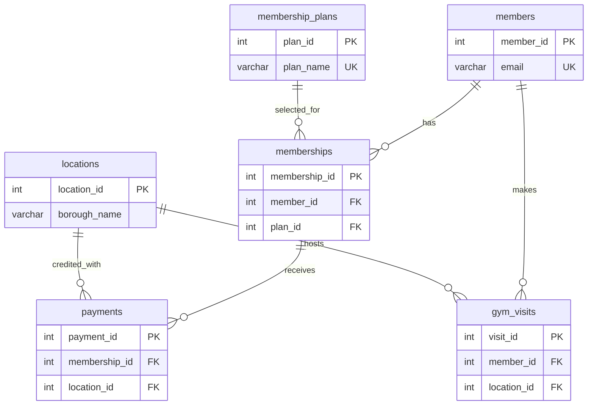

# Step 4 — Database Normalization: From One Record to Six Tables

**Project:** CIS 3400 · Luxury Gym Management Database  
**Database:** MySQL 8 · `luxury_gym`  
**Final result:** **6 tables · 34 columns · 6 primary keys · 6 foreign keys**

> [!NOTE]
> This is a **step-by-step reconstruction** of how we *could* arrive at the project's final schema. The early "before" tables are **teaching examples**, not previous versions found in the repository. The final six tables and column names come from [`sql/00_create_database.sql`](../sql/00_create_database.sql).

## The big picture

**Normalization = give each fact one appropriate home.** Instead of repeating a member's name, plan details, and branch address every time the member visits or pays, store those descriptions once and connect records with IDs.



| Stage | Main question | What we fix |
|---|---|---|
| **UNF** | Are several values stored together? | Repeating groups such as lists of visits |
| **1NF** | Can every value and row be identified individually? | Multiple values inside one field |
| **2NF** | Does a fact depend on **all** parts of its candidate key? | Partial dependencies on composite keys |
| **3NF** | Does a descriptive fact really belong to this entity? | Transitive dependencies and repeated descriptions |

**Notation:** `PK` = primary key · `FK` = foreign key · `A → B` = "A determines B" · `NULL` = missing/unknown or not yet recorded.

---

## Step 0 — Start with an unnormalized record (UNF)

Imagine the gym starts by keeping *everything about a membership* in a single record:

| Field | Example value |
|---|---|
| `member_id` | `1` |
| `member_name` | Ana Ruiz |
| `membership_id` | `10` |
| `plan_name` | Plus Monthly |
| `plan_price` | `125.00` |
| **`visits`** | **`101: Queens; 102: Manhattan`** |
| **`payments`** | **`201: $125; 202: $125`** |

*Fictional example only, not data copied from the project's inserts.*

### What's wrong?

The bold cells hold **lists**, not one value. Worse, member information, plan information, visits, and payments are all mixed together.

> [!WARNING]
> **Four common problems (anomalies)**
>
> - **Update:** If Ana changes her email, we may have to correct it in many records.
> - **Insert:** We cannot conveniently store a brand-new plan with no subscribers yet.
> - **Delete:** Deleting the final visit could accidentally delete the only copy of a member's details.
> - **Duplicate:** The same plan price or branch name is repeated across records.

Visits and payments are also **different kinds of events**. If we flatten two visits and two payments into one joined table, we might get **2 × 2 = 4 rows**—four combinations, even though only two visits and two payments occurred.

**Goal:** Separate repeated events and identify which facts describe members, plans, subscriptions, locations, visits, and payments.

---

## Step 1 — First Normal Form (1NF)

### Rule: one value in each field, one identifiable record per row

**Before:** one cell contains multiple visits:

| member_id | visits |
|---|---|
| 1 | `101: Queens; 102: Manhattan` |

**After:** each visit is its own row:

| visit_id (PK) | member_id | location_id | check_in_at |
|---|---|---|---|
| 101 | 1 | 1 | `2026-11-03 08:00:00` |
| 102 | 1 | 2 | `2026-11-05 18:00:00` |

The branch identifiers are illustrative; here `1` and `2` stand for two different locations.

We do the **same for payments**: payment `201` and payment `202` become **two distinct payment records** rather than one comma-separated list.

### Why this is better

- Every `visit_id` identifies exactly one visit.
- One member can have many visits without adding columns such as `visit_1`, `visit_2`, `visit_3`.
- Each timestamp is one value, and every payment has its own ID.
- A visit can be added without changing another visit.

**Important:** 1NF **does not yet remove all repeated descriptions**. A 1NF table could still repeat a member's email or a branch's borough in every visit row. That is why we continue.

**Result of Step 1:** Atomic fields and individually identified records. ✅

---

## Step 2 — Second Normal Form (2NF)

### Rule: a non-key fact must not depend on only part of a composite candidate key

Suppose we temporarily describe subscriptions using the **illustrative composite key**:

```text
(member_id, plan_id, start_date)
```

A flat table might look like this:

| member_id | plan_id | start_date | member_email | plan_name |
|---|---|---|---|---|
| 1 | 2 | 2026-11-01 | ana@example.com | Plus Monthly |
| 2 | 2 | 2026-11-02 | ben@example.com | Plus Monthly |

The first three fields **together** identify a subscription in this example. But:



- `member_id → member_email`: the email depends on **just the member**, not the whole composite key.
- `plan_id → plan_name`: the plan name depends on **just the plan**, not the whole composite key.

These are **partial dependencies**.

### Fix: separate the facts

**`members`**

| member_id (PK) | email |
|---|---|
| 1 | ana@example.com |
| 2 | ben@example.com |

**`membership_plans`**

| plan_id (PK) | plan_name |
|---|---|
| 2 | Plus Monthly |

**`memberships`**

| membership_id (PK) | member_id (FK) | plan_id (FK) | start_date |
|---|---|---|---|
| 10 | 1 | 2 | 2026-11-01 |
| 11 | 2 | 2 | 2026-11-02 |

Now, updating the plan name happens **once** in `membership_plans`, not in every member's subscription.

> [!IMPORTANT]
> The project **actually uses `membership_id` as a single-column primary key**; the composite key above was only for explaining 2NF. A single-column key makes partial dependencies on that key impossible, but **we still must examine all candidate keys and actual business rules**. Adding an ID to a poorly designed table does not automatically make the table normalized.

**Result of Step 2:** Member descriptions, plan descriptions, and individual subscriptions have separate places. ✅

---

## Step 3 — Third Normal Form (3NF)

### Rule: avoid non-key facts that depend on other non-key facts

Imagine we stored the borough directly beside **every gym visit**:

| visit_id (PK) | member_id | location_id | borough_name | check_in_at |
|---|---|---|---|---|
| 101 | 1 | 1 | Queens | 2026-11-03 08:00 |
| 102 | 1 | 1 | Queens | 2026-11-04 09:00 |

The dependency chain is:


- A visit identifies the **location visited**.
- A location identifies its **borough**.
- So storing `borough_name` in each visit repeats a fact about the **location**, not the visit itself.

### Fix: put each fact where it belongs

**`locations` — the branch's information**

| location_id (PK) | location_name | borough_name |
|---|---|---|
| 1 | Queens Branch | Queens |
| 2 | Manhattan Branch | Manhattan |

**`gym_visits` — the individual visit**

| visit_id (PK) | member_id (FK) | location_id (FK) | check_in_at |
|---|---|---|---|
| 101 | 1 | 1 | 2026-11-03 08:00 |
| 102 | 1 | 2 | 2026-11-05 18:00 |

Now `borough_name` lives in **`locations`**. A SQL `JOIN` can recover it for reporting.

### Apply the same idea to payments

A payment should not copy `member_email`, `plan_name`, or `borough_name`. The actual payment record needs only:

| payment_id (PK) | membership_id (FK) | location_id (FK) | amount | paid_at |
|---|---|---|---|---|
| 201 | 10 | 1 | 125.00 | 2026-11-01 |

To find the member or plan, follow `payments → memberships → members / membership_plans`. To find the borough, follow `payments → locations`.

**Result of Step 3:** Repeated descriptions are moved to their owning entities, and relationships are represented by foreign keys. ✅

---

## Step 4 — The six final tables in our repository

The following list is **the actual implemented design**, not a simplified example. It matches [`sql/00_create_database.sql`](../sql/00_create_database.sql).

| Table | PK | Other implemented columns | Why this table exists |
|---|---|---|---|
| **`members`** (7) | `member_id` | `first_name`, `last_name`, `email`, `phone`, `date_of_birth`, `joining_date` | Store member information once |
| **`membership_plans`** (5) | `plan_id` | `plan_name`, `plan_level`, `duration`, `price` | Define reusable plans |
| **`locations`** (6) | `location_id` | `location_name`, `borough_name`, `opening_time`, `closing_time`, `is_active` | Store branch details once |
| **`memberships`** (6) | `membership_id` | `member_id` **FK**, `plan_id` **FK**, `start_date`, `end_date`, `created_at` | Track each subscription |
| **`gym_visits`** (5) | `visit_id` | `member_id` **FK**, `location_id` **FK**, `check_in_at`, `check_out_at` | Track each gym entry and exit |
| **`payments`** (5) | `payment_id` | `membership_id` **FK**, `location_id` **FK**, `amount`, `paid_at` | Track each payment and credited branch |

**Count check:** 7 + 5 + 6 + 6 + 5 + 5 = **34 columns**. The design has **6 primary keys** and **6 foreign keys**.

### How the tables connect (Crow's Foot diagram)



*The diagram highlights keys and selected attributes for readability. The table above lists every implemented column.* In the diagram, the "many" side can have zero or many rows; every child record's foreign keys reference existing parent rows.

### Three relationships worth remembering

| Relationship | Why it matters |
|---|---|
| `members → memberships → membership_plans` | A member can subscribe repeatedly over time; plan details are not copied into each subscription |
| `members → gym_visits → locations` | A valid member can visit **any active branch**; `gym_visits.location_id` is the actual branch visited |
| `memberships → payments → locations` | A payment belongs to a subscription and is **credited** to a branch; that branch need not match the one visited |

A member is found from a payment by joining `payments.membership_id` to `memberships.membership_id`, then following `memberships.member_id`. No `payments.member_id` is needed.

---

## Step 5 — How normalized data still produces useful reports

> **Question:** "Show each member's membership plan."

We **join** separate tables when we query. We do **not** store repeated plan names in `memberships`.

```sql
USE luxury_gym;

SELECT
    m.member_id,
    m.first_name,
    m.last_name,
    mp.plan_name,
    ms.start_date,
    ms.end_date
FROM memberships AS ms
JOIN members AS m
    ON ms.member_id = m.member_id
JOIN membership_plans AS mp
    ON ms.plan_id = mp.plan_id;
```

This report can display member names and plan names together, while those facts remain stored **once in their proper tables**.

For **revenue by borough**, join `payments` to `locations` on `location_id`, then sum `payments.amount` by `locations.borough_name`.

---

## Step 6 — Verify that our design is consistent with 3NF

### Quick checklist

- [x] **1NF:** No repeating visit/payment lists; individual rows have primary keys.
- [x] **2NF:** No documented partial dependencies on a composite candidate key.
- [x] **3NF:** Member, plan, and branch descriptions are kept in their own tables.
- [x] **Relationships:** Exactly six required, non-null foreign keys connect the six tables.
- [x] **No invented entities:** Only the six approved tables are used.

| Table | Assessment | Main reason |
|---|---|---|
| `members` | Consistent with 3NF | Member fields depend on the member key |
| `membership_plans` | Consistent with 3NF | Plan details depend on the plan key |
| `locations` | Consistent with 3NF | Borough and hours describe the branch |
| `memberships` | Consistent with 3NF* | Membership-specific dates and references, no copied plan/member descriptions |
| `gym_visits` | Consistent with 3NF | Visit-specific timestamps and references |
| `payments` | Consistent with 3NF | Payment-specific amount, date, and references |

*\*The conclusion about `memberships` assumes `end_date` is a recorded, potentially independently determined subscription end date, not always a redundant calculation from `start_date` and `membership_plans.duration`. Normal form claims depend on actual business functional dependencies, not just SQL column definitions.*

### Normalization is not the same as validation

The actual SQL schema also uses:

- `UNIQUE` on `members.email` and `membership_plans.plan_name`.
- `NOT NULL` on required fields and all six foreign keys.
- `CHECK` constraints for positive plan duration, positive plan price, positive payment amount, and sensible end/check-out dates.
- `locations.is_active` defaulting to `TRUE`.

These rules improve **data integrity**, but do not prove a normal form by themselves.

### Why some similar-looking values belong in different tables

| Fields | Why both are kept |
|---|---|
| `membership_plans.price` / `payments.amount` | Listed plan price versus actual recorded payment; do not assume the values must match |
| `membership_plans.duration` / `memberships.end_date` | Standard plan duration versus the recorded end of a particular subscription |
| `gym_visits.location_id` / `payments.location_id` | Branch visited versus branch credited with the payment |

Also, `check_out_at` can be `NULL` for an unfinished visit; `end_date` can be `NULL` if an ending is not recorded. A null `end_date` does **not** automatically prove a subscription is active. Membership eligibility and whether a branch is active require additional application/query logic; foreign keys alone do not enforce those rules.

---

## Final takeaway

```text
ONE member        → members
ONE plan          → membership_plans
ONE branch        → locations
ONE subscription  → memberships
ONE gym visit     → gym_visits
ONE payment       → payments
```

**The guiding idea:** *Store a fact once, in the table representing that fact; connect related facts through IDs; combine them with JOINs when analyzing data.*

Our **six-table, 34-column** MySQL design is **consistent with Third Normal Form under the documented business assumptions**. This normalization review does **not** change the project schema or require new tables.

### Repository references

- [Step 1 — Business requirements](01_Business_Requirements.md)
- [Step 2 — Entities and attributes](02_entities_and_attributes.md)
- [Step 3 — ER diagram and logical design](03_database_design.md)
- [Implemented database schema](../sql/00_create_database.sql)
